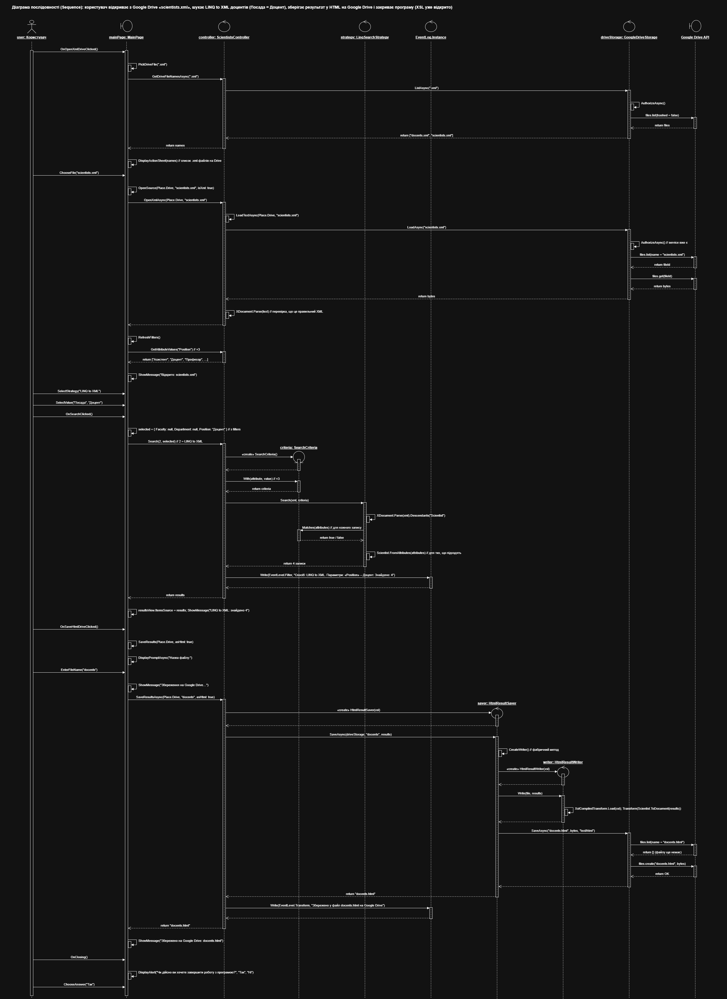

# Lab 2* - XML processing (topic 19 "Scientific staff: salary")

.NET MAUI app (Windows) that searches an XML file of scientific staff and exports the filtered records to XML or HTML (via XSL).

## Features
- Search by attributes (faculty, department, position); the values come from the opened XML file.
- Records have a different number of attributes: the optional `Degree` attribute is present only for some scientists.
- Three ways to parse XML, chosen with the **Strategy** pattern: SAX (`XmlReader`), DOM (`XmlDocument`), LINQ to XML.
- XSL transformation of the filtered records to HTML (`XslCompiledTransform`).
- Saving results through the **Factory Method** pattern (`XmlResultSaver`, `HtmlResultSaver`).
- Google Drive: open XML/XSL from Drive, upload them, save filtered XML/HTML to Drive.
- Event log as a **Singleton** (`EventLog`): levels Filter / Transform / Save, written to `log.txt`.
- Main menu duplicated by buttons, Clear button, help, exit confirmation.

## Structure
- `src/Scientists.Core` - model, search strategies, savers, logger, storage, controller.
- `src/Scientists.UI` - MAUI window.
- `tests/Scientists.Tests` - xUnit tests.
- `samples` - example `scientists.xml` and `scientists.xsl`.

## Run
```
dotnet run --project src/Scientists.UI -f net8.0-windows10.0.19041.0
dotnet test tests/Scientists.Tests
```

Results, the log and the Google credentials live in `Documents\Scientists19`.
For Google Drive put an OAuth client (`Desktop app`) there as `client_secret.json`; it is never committed.

## UML diagrams

Use-case:


Class:


Sequence:



draw.io file: docs/uml/lab2_uml.drawio
