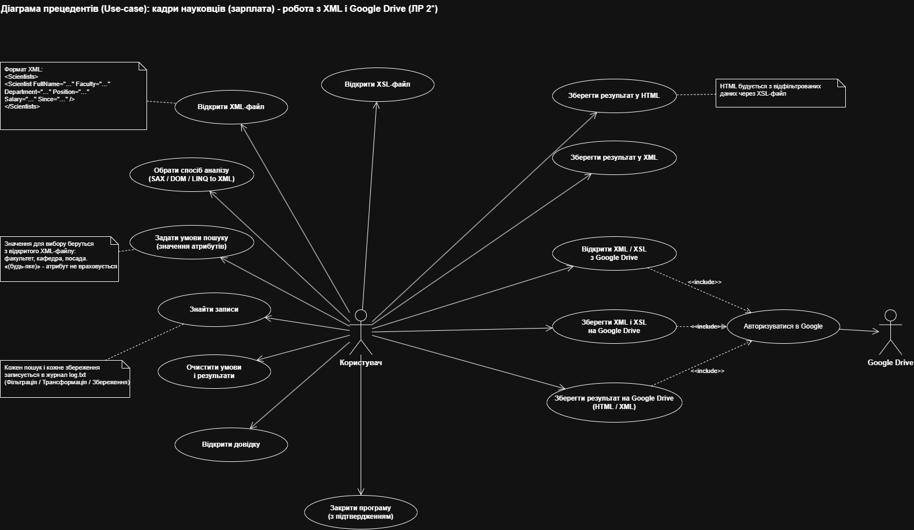
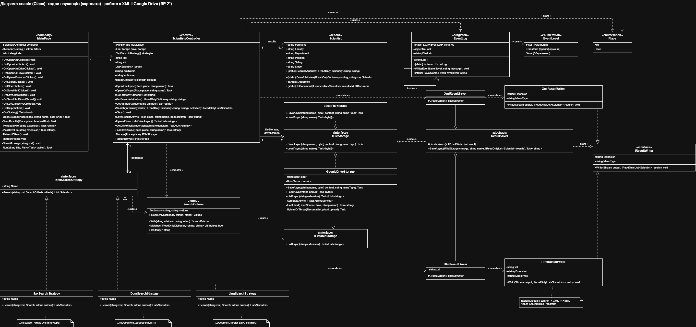

# Lab 2*. XML files

OOP, 2nd year. C#, .NET MAUI.

Topic 19 "Scientific staff (salary)": full name, faculty, department, position, salary, year since.

The program opens an XML file with scientists, finds records by faculty, department and position,
and saves the result to XML or to HTML (using an XSL file). Files can be opened from and saved to Google Drive.

Search works in three ways: SAX, DOM, LINQ to XML.
Patterns: Strategy (search), Factory Method (saving), Singleton (event log).

## Test files

Examples in `samples/`:
- `scientists.xml` - 16 scientists (the `Degree` attribute is not in every record)
- `scientists.xsl` - turns the result into an HTML table

## UML diagrams

Use-case:

Class:

Sequence:

draw.io file: docs/uml/lab2_uml.drawio
